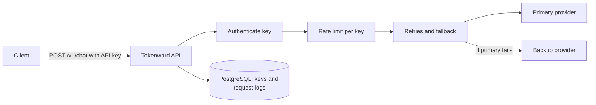

# Tokenward

[](https://github.com/arana1000/tokenward/actions/workflows/ci.yml)

An LLM API gateway. Applications call one authenticated endpoint, and Tokenward
handles API keys, rate limiting, retries, provider fallback and usage and cost
logging in front of the model providers.

**Live demo:** https://tokenward.onrender.com/docs

The demo runs on a free tier, so the first request after a quiet period can take
about a minute while the service wakes up. Chat endpoints need an API key. The
health checks at `/health` and `/ready` are open.

## Why

Calling LLM providers directly from every application means each one has to
handle provider outages, rate limits, key management and cost tracking for
itself. A gateway does that once, in one place.

## How a request flows



1. The API key is hashed and looked up. Missing, wrong and revoked keys all get
   the same 401.
2. A per-key token bucket decides whether the request may proceed. If not, the
   client gets a 429 with a `Retry-After` header and no provider is called.
3. The request goes to the primary provider for the requested model. Retryable
   failures are retried with exponential backoff and jitter, then the next
   provider is tried.
4. The outcome is logged with latency, token counts, estimated cost and the
   number of provider calls it took.

## Features

- **API keys:** created and revoked from a CLI. Only a SHA-256 hash is stored,
  so the key is shown once and a database leak exposes nothing usable.
- **Provider interface:** every provider implements the same small interface and
  translates its own failures into a shared set of errors, each marked retryable
  or not.
- **Retries and fallback:** up to three attempts per provider with exponential
  backoff and jitter, then failover to the next provider. Non-retryable errors
  stop immediately.
- **Rate limiting:** a thread-safe token bucket per key, configurable through
  `RATE_LIMIT_PER_MINUTE`.
- **Request logging:** every authenticated request is recorded. A logging
  failure never fails the client's request.
- **Mock provider:** a built-in fake provider that can time out, error, rate
  limit or respond slowly on demand, used to test every failure path.

## API

| Method | Path | Auth | Purpose |
|---|---|---|---|
| GET | `/health` | No | Liveness: the process is running |
| GET | `/ready` | No | Readiness: the database is reachable |
| GET | `/v1/me` | Yes | Details of the calling API key |
| POST | `/v1/chat` | Yes | Send a chat request through the gateway |

Send the key as `Authorization: Bearer <key>`.

Example request body:

```json
{
  "model": "mock-1",
  "messages": [{"role": "user", "content": "Hello"}]
}
```

## Tech stack

Python 3.14, FastAPI, PostgreSQL 17, SQLAlchemy 2, Alembic, pytest, Docker,
GitHub Actions. Deployed on Render with Neon Postgres.

## Run it locally

Requires Docker. Copy `.env.example` to `.env`, set a password, then:

```
docker compose up -d --build
```

The API is at http://127.0.0.1:8000 and the docs at http://127.0.0.1:8000/docs.

Create an API key:

```
docker compose exec api python -m app.cli create-key --name "my key"
```

## Tests

```
cd backend
python -m venv .venv
.venv/Scripts/activate        # Windows. On macOS or Linux: source .venv/bin/activate
pip install -r requirements-dev.txt
docker compose up -d db
alembic upgrade head
pytest
```

Unit tests cover key generation, pricing, the rate limiter, retry and fallback
logic and the mock provider. Integration tests run the real endpoints against
PostgreSQL. CI runs the full suite on every push.

## Design decisions

- **SHA-256 for API keys, not bcrypt.** Slow hashes exist to protect short,
  guessable passwords. API keys are long random strings, so a fast hash is
  already infeasible to reverse and cheap enough to check on every request.
- **Token bucket, not a fixed window.** A fixed per-minute counter allows double
  the limit across a window boundary. A token bucket caps bursts at the bucket
  size and the long-run rate at the refill rate.
- **Jitter on retries.** Without it, clients that fail together retry together
  and overload a recovering provider again.
- **Decimal for cost.** Floating point cannot represent most decimal fractions
  exactly, and the errors add up across many small charges.
- **One error for every authentication failure.** Telling a caller that a key is
  revoked rather than wrong would confirm that it was once valid.

## Known limitations

- Only a mock provider is implemented so far. Real providers are next.
- Rate limiting is held in memory, so limits reset when the app restarts and are
  not shared between instances. Running several instances would need a shared
  store such as Redis.
- Endpoints are synchronous, so concurrent requests are capped by the worker
  thread pool.
- Retrying a timed-out request can result in paying a provider twice, because
  the first attempt may have completed. This is accepted in exchange for
  reliability.
- Migrations run when the container starts, which suits a single instance.

## Roadmap

- [ ] A real LLM provider
- [ ] Usage and cost endpoints
- [ ] Dashboard
- [ ] Streaming responses